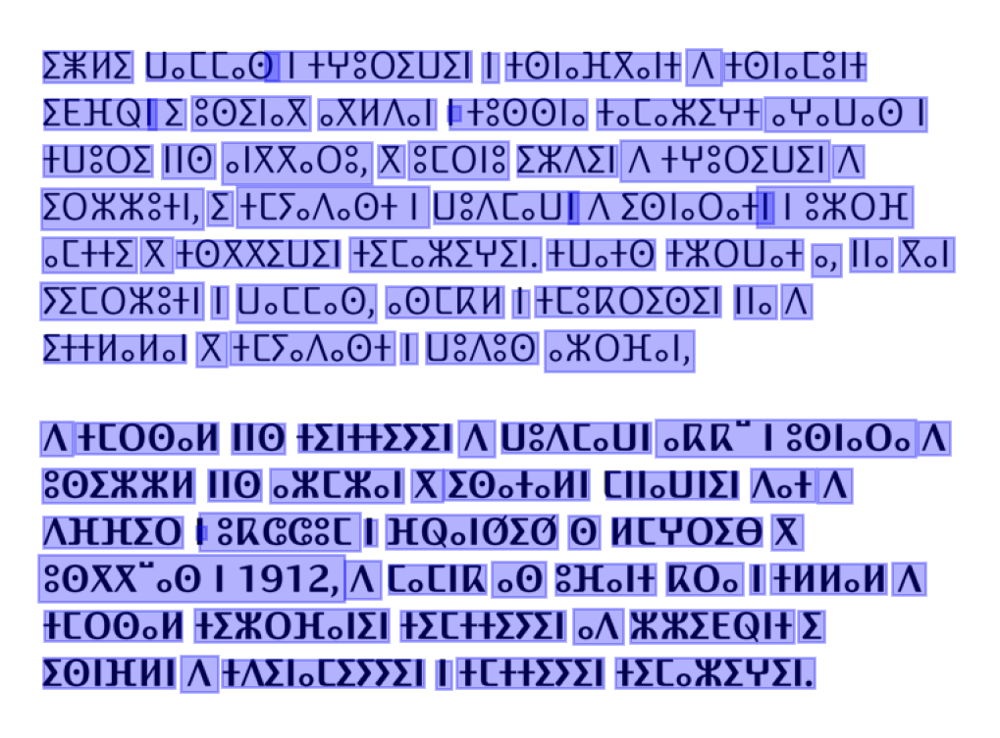
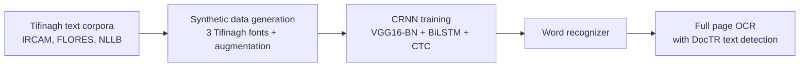

# Tifinagh OCR: text recognition for the Amazigh script

> Deep learning OCR for Tifinagh, the script used to write Amazigh (Tamazight) in Morocco. Tifinagh is a low-resource script with almost no labeled data and no ready-made OCR model, so the full pipeline was built from scratch: synthetic data generation, a CRNN model in PyTorch, training and evaluation.



## Results

| Metric | Score |
|---|---|
| Character accuracy | **98.7%** |
| Exact word match | **95.3%** |

Evaluated on 8,000 synthetic word images. The trained recognizer is also plugged into a full-page pipeline (text detection + recognition) to read whole documents, as shown above.

## How it works



1. **Data generation**: since no labeled dataset exists, word images are rendered from Tifinagh text corpora with several fonts.
2. **Model**: a CRNN with a VGG16-BN feature extractor, a bidirectional LSTM for sequence modeling and CTC loss for alignment-free training.
3. **Training**: OCR-specific augmentation (perspective, elastic deformation, noise, blur, lighting), progressive augmentation, cosine / OneCycle schedulers, Weights & Biases tracking.
4. **Inference**: single image or batch, with confidence scores and evaluation (exact match, character accuracy).

## Tech stack

Python, PyTorch, torchvision, DocTR, OpenCV, Albumentations, imgaug, Pillow, Weights & Biases

## Project structure

```
data_generation.py         Synthetic training data from text corpora and fonts
vocab_config.py            Tifinagh vocabulary (~150 characters + special tokens)
train_tifinagh_crnn.py     Main CRNN training (custom augmentations, monitoring)
train_crnn.py              Alternative training with DocTR
inference_tifinagh.py      Inference, batch prediction and evaluation
demo_full_page_ocr.ipynb   Full page OCR demo
corpus/                    Tifinagh text corpora
fonts/                     Tifinagh fonts used for rendering
inference_results/         Evaluation outputs
```

## Run it

```bash
pip install -r requirements.txt

# 1. Generate synthetic data
python data_generation.py --corpus_dir ./corpus --output_dir ./data --fonts_dir ./fonts \
    --corpus_files zgh/IRCAM-clean-tifinagh.txt --train_samples 8000 --val_samples 1000

# 2. Train
python train_tifinagh_crnn.py --data_dir ./data --epochs 20 --scheduler cosine --save_dir ./checkpoints

# 3. Predict
python inference_tifinagh.py --model_path ./checkpoints/best_model.pth --image_path ./images/0.jpg
```

## Data sources

Text corpora from IRCAM and the FLORES / NLLB seed datasets (Tamazight in Tifinagh script). Fonts include Tifinaghe-IRCAM Unicode.

## Author

Wafa Jaafar · [LinkedIn](https://www.linkedin.com/in/wafajaafar/) · [GitHub](https://github.com/JaafarWafa/)
